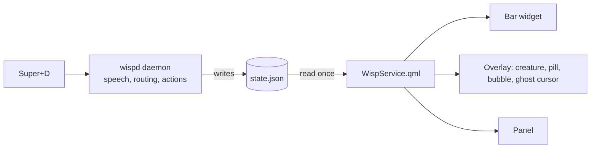

<p align="center">
  <picture>
    <source media="(prefers-color-scheme: dark)" srcset="assets/brand/lockup-dark.svg">
    
  </picture>
</p>

<p align="center"><b>A small light in your Omarchy bar that listens, thinks, and points at what it is doing.</b></p>

omarchy-wisp is the [Omarchy](https://learn.omacom.io/2/the-omarchy-manual) shell plugin for [Wisp](https://github.com/duketopceo/wisp), a voice companion for Hyprland. Press `Super+D`, speak, and the plugin shows the state: a bar mark, a creature, a listening pill, an answer bubble beside your cursor, a ghost cursor that travels to targets, and a panel (Now, Agents, Memory, Settings). Colours, corner rounding and font come from your active Omarchy theme.

> **Needs `wispd`.** This repository holds only the Quickshell plugin. It draws the state that the [wispd](https://github.com/duketopceo/wisp) daemon writes; without the daemon it shows a disconnected state.

<!-- TODO(screenshot): replace with a 6-8 s capture of the real plugin (Super+D, pill, creature, bubble, ghost cursor) on two Omarchy themes. Tracked as U10 in the roadmap plan. No screenshot is shown because none has been captured from this repository yet. -->

## Install

1. Install and start the daemon (pinned to the v0.9.0 commit):

   ```sh
   git clone https://github.com/duketopceo/wisp
   git -C wisp checkout 6b7d80114d99e61d0ceb4782d321ec4df96fd593  # wispd v0.9.0
   cd wisp && python3 wispd install
   systemctl --user enable --now wispd
   ```

2. Add the plugin:

   ```sh
   omarchy plugin add https://github.com/duketopceo/omarchy-wisp.git --enable
   ```

   Omarchy plugins run unsandboxed under your user account and share the shell process; read the code before enabling ([Omarchy plugin guide](https://plugins.omarchy.org/develop.html)).

## Quick start

Press `Super+D` (the bind is installed by `wispd install`) and speak. Bar widget: left click talks, middle click stops, right click opens the panel (`manifest.json`, bar widget description).

Remove with `omarchy plugin remove io.github.duketopceo.wisp`.

## How it works



State flows one way. `WispService.qml` is the single reader of `$XDG_RUNTIME_DIR/wisp/state.json` and turns the active Omarchy theme into tokens (`lib/tokens.js`); the bar, overlay and panel bind to it. Overlays take no keyboard focus. The creature is one shader (`shaders/wisp.frag.qsb`) driven by a state model (`lib/creature.js`). The design is documented in [DESIGN.md](DESIGN.md).

## Status

Version `0.4.0`. This repository is a copy of the monorepo's `shell-plugin/` directory and is currently behind it; the [roadmap plan](docs/plans/2026-10-10-001-feat-omarchy-wisp-program-roadmap-plan.md) starts with re-syncing and automating that. See [ROADMAP.md](ROADMAP.md) and the [landscape research](docs/research/2026-10-10-landscape.md).

## Contributing

The plugin is authored in [duketopceo/wisp](https://github.com/duketopceo/wisp) (`shell-plugin/`). Open issues and pull requests about plugin behaviour there. Packaging, docs and brand changes belong here. The logo set in `assets/brand/` is a proposal pending the owner's sign-off.

## License

MIT, see [LICENSE](LICENSE).
